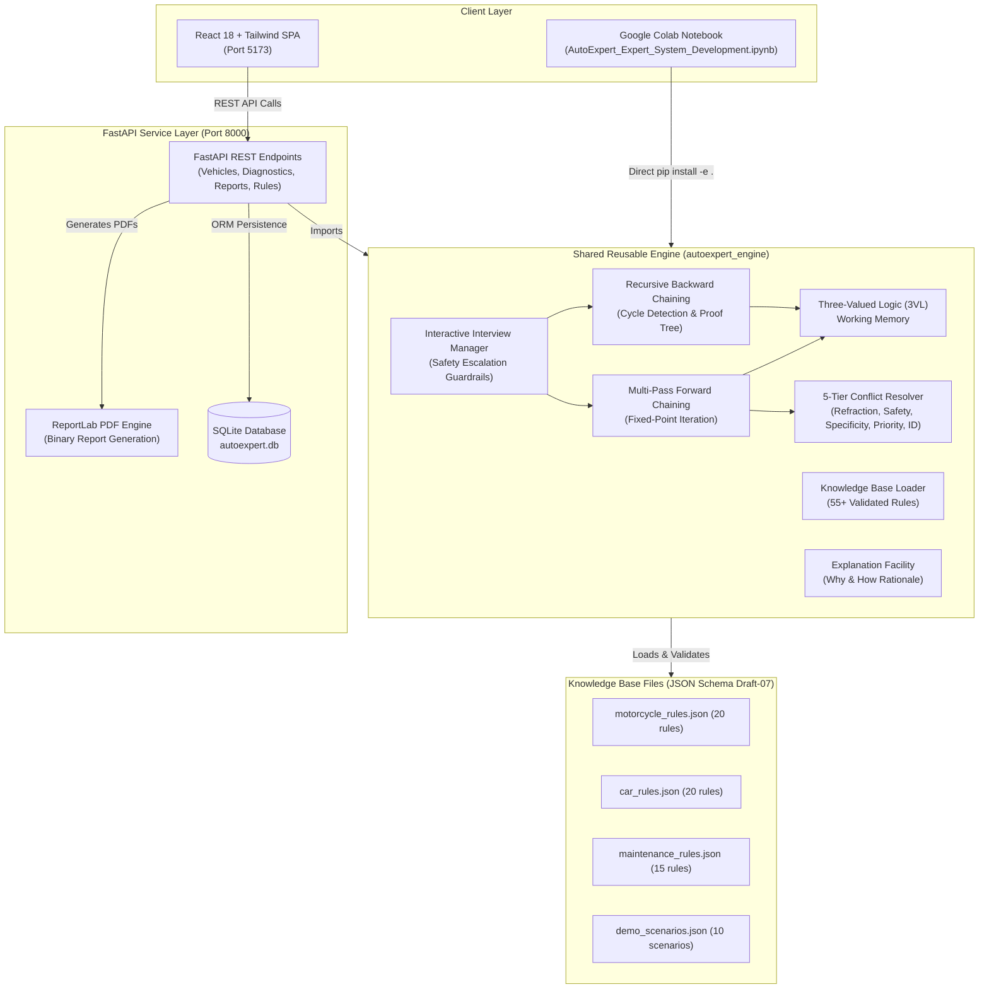
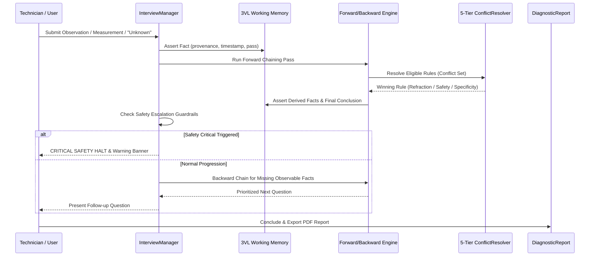

# AutoExpert — System Architecture

## 1. High-Level Architecture Overview

AutoExpert is designed as a **pure symbolic, knowledge-based expert system** that unifies diagnostic inference for motorcycles and cars. The system strictly separates knowledge representation and inference logic from UI rendering and API endpoints through a shared, UI-independent Python engine package: `autoexpert_engine`.

---

## 2. Shared Engine Package (`autoexpert_engine`)

The core inference logic is packaged via `pyproject.toml` into `autoexpert_engine`.
- **Zero inference code duplication:** Both the FastAPI backend and the academic Colab notebook import the exact same modules.
- **UI-independent:** Operates entirely in pure Python with no web or display dependencies.
- **Strict schema validation:** All rules loaded into memory are verified at runtime using `jsonschema` against `knowledge_base/rule_schema.json`.

---

## 3. Data & Memory Flow

---

## 4. Database Schema (SQLAlchemy 2.0 + SQLite)

1. `vehicles`: Persistent motorcycle & car profiles with data provenance flags (`User-Entered`, `Verified`, `Estimated`).
2. `diagnostic_sessions`: In-progress and completed interactive interviews.
3. `session_facts`: Historical audit log of every asserted fact, symptom, and measurement.
4. `diagnostic_reports`: Immutable diagnostic snapshots storing evidence scores, triggered rule IDs, and full inference chains.
5. `maintenance_records`: Completed service logs.
6. `maintenance_reminders`: Upcoming service milestones and custom inspection intervals.
7. `user_preferences`: Local settings (distance units, pressure units, playback speeds).
